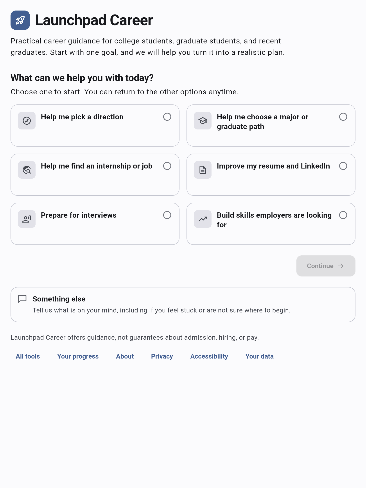
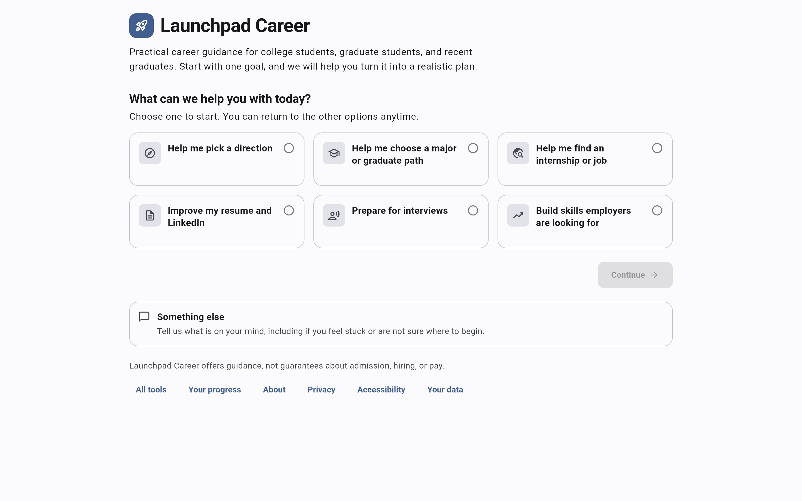
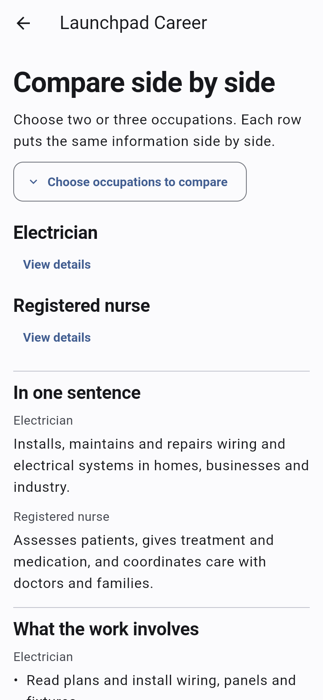
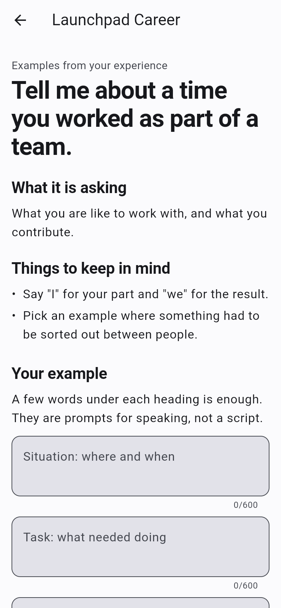
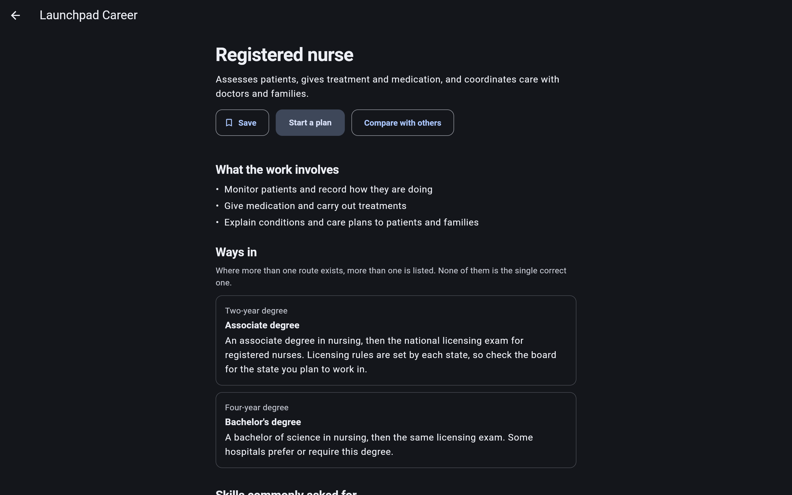

# Launchpad Career

Cross-platform career planning and employment guidance for students and recent graduates.

Launchpad Career helps undergraduates, graduate students, recent graduates, and career
changers turn one goal into a realistic plan, in a labour market being reshaped by
automation, thin entry-level hiring, and economic uncertainty.

It is a career-planning and employment-guidance tool. It is **not** a mental-health
service, and it makes no medical, psychological, diagnostic, legal, or
guaranteed-employment claims.

---

## Project status

**Phases 1 to 5 are built and tested, and Phase 6 (release) is prepared but nothing is
released.** Built: the home screen, onboarding questions, opt-in local storage with export
and deletion, career exploration (browse, compare, save, rule-based suggestions with
visible reasons, action plans), the employment tools (weekly job-search plan, résumé and
LinkedIn guides, interview practice, skills plan, progress), and an optional account with
explicit, consented sync, backed by a small server in `services/launchpad_server`.
Prepared: a web build that makes no third-party requests (proved by a browser network
trace in CI), release and deployment workflows, and briefs for the reviews that only
people can do.

What "built" does not mean, and the interface says so wherever it matters:

- Occupation descriptions and tool guidance are AI-assisted drafts awaiting review by a
  careers adviser.
- No pay figures are loaded yet, so none are shown.
- The server is not deployed anywhere and has not been independently security-reviewed.
  The default build has no accounts and makes no network requests.
- Nothing is deployed, signed or submitted to a store. The release and deployment
  workflows have never been run.
- There has been no accessibility audit, no legal or privacy review, and no independent
  security review. The product claims no conformance and no compliance.

The record of what is done is [`docs/product/roadmap.md`](docs/product/roadmap.md).

Verified against Flutter 3.44.8 / Dart 3.12.2 with `./tool/dev.sh ci` (format check,
analyze, and every package's tests). The command prints the current test counts; they are
not repeated here because they go stale.

Not yet verified: iOS and Linux builds. Android, Windows and macOS debug builds and the web
release build run in CI (see [Known limitations](#known-limitations)).

## Target audience

Undergraduates, graduate students, recent graduates, and career changers — plus the
university career offices and workforce organisations that may put the product in front of
them.

## Screenshots

Captured from the release web build by `tool/web_audit/audit.cjs`.

| Phone | Tablet | Desktop |
| --- | --- | --- |
|  |  |  |
|  |  |  |

More in [`docs/product/screenshots/`](docs/product/screenshots/). Native builds have not
been captured.

## Supported platforms

One Flutter codebase targets:

- Android (and therefore ChromeOS, via the Android runtime)
- iOS
- Windows
- macOS
- Linux
- Web (and therefore ChromeOS, via the browser)

ChromeOS is not a separate Flutter target; it is covered by the Android and web builds.

## Architecture summary

Five app packages with path dependencies, and one standalone server package:

```
launchpad-career/
├── apps/
│   └── launchpad_app/          Flutter application: routing, features, l10n, tests
├── packages/
│   ├── launchpad_core/         Design tokens, themes, breakpoints, a11y helpers
│   ├── launchpad_domain/       Pure Dart: entities + repository interfaces
│   ├── launchpad_data/         Catalogues, opt-in local persistence, account client
│   └── launchpad_ui/           Shared widgets (goal card, grid, tiles)
├── docs/
├── .github/
├── services/
│   └── launchpad_server/       Optional account and sync server (pure Dart, shelf)
└── tool/
```

Dependencies point one way: `app → ui → core`, `app → data → domain`. `launchpad_domain`
has no Flutter dependency at all, which is why icons are carried as enum tokens
(`GoalIcon`) and resolved to `IconData` in `launchpad_ui`.

State management is Riverpod; routing is `go_router`, declarative, with deep-linkable
URLs. See [`docs/architecture/architecture-overview.md`](docs/architecture/architecture-overview.md).

**No Melos.** The suggested structure listed `melos.yaml`; five packages with path
dependencies do not need a bootstrap tool. `tool/dev.sh` runs get/format/analyze/test
across all of them in about the same number of keystrokes. Revisit if the package count
grows or packages start being published.

## Prerequisites

- Flutter **3.44.8** stable or newer (Dart ≥ 3.6 — the code uses `Color.withValues`)
- Git
- Per-platform toolchains only for the platforms you actually build:
  Android Studio + JDK 17 (Android), Xcode (iOS/macOS), Visual Studio with the
  "Desktop development with C++" workload (Windows)

## Setup

```bash
git clone https://github.com/<owner>/launchpad-career.git
cd launchpad-career
./tool/dev.sh get
```

Native platform folders are not committed (they are generated, and they are where signing
material tends to leak in). Generate them before your first native build:

```bash
cd apps/launchpad_app
flutter create --org com.launchpadcareer --platforms=android,ios,windows,macos,linux .
```

## Run the app

```bash
cd apps/launchpad_app
flutter run -d chrome      # web
flutter run -d macos       # or windows, linux
flutter run                # attached mobile device or emulator
```

## Run the tests

```bash
./tool/dev.sh test                    # every package
cd apps/launchpad_app && flutter test  # just the app
flutter test integration_test/app_test.dart -d chrome   # integration, needs a device
```

`./tool/dev.sh ci` runs format, analyze, and test exactly as CI does.

## Platform build commands

```bash
cd apps/launchpad_app
flutter build web --release
flutter build apk --debug            # unsigned verification build
flutter build appbundle --release    # requires signing config, not in this repo
flutter build windows --release
flutter build macos --release
flutter build linux --release
flutter build ios --no-codesign
```

## Accessibility commitments

Not aspirations — these are enforced by tests in `test/accessibility_test.dart` and
`packages/launchpad_core/test/contrast_test.dart`:

- Every interactive element is reachable and operable from the keyboard; Enter and Space
  activate cards through `ActivateIntent` rather than hand-rolled key handling.
- Card descriptions are in the semantics tree at all times, whatever the visual state.
  Hover is never the only route to information.
- Selection is announced (`Semantics.selected`, `inMutuallyExclusiveGroup`) and shown with
  an explicit indicator, never by colour alone.
- Text and interactive colours are opaque so contrast is computable, and body and
  secondary text meet WCAG 2.1 AA in both themes.
- Touch targets are at least 48dp; the layout survives a 2× system text scale without
  overflow.
- "Reduce motion" is honoured through `AppMotion`; no essential content is hidden behind
  animation.

Details and known gaps: [`docs/accessibility/accessibility-requirements.md`](docs/accessibility/accessibility-requirements.md).

## Privacy principles

- Anonymous by default. No name, no email, no account to explore.
- Data minimisation: nothing is requested that is not needed for the answer being given.
- Free text stays in memory only; it is never logged and never sent to analytics.
- No third-party analytics, ads, or tracking SDKs in the dependency tree.
- No compliance claims (FERPA, GDPR, COPPA, or any other) until legal and technical review
  is complete. The privacy screen is an explicit placeholder.

Details: [`docs/privacy/privacy-design.md`](docs/privacy/privacy-design.md).

## Contributing

See [CONTRIBUTING.md](CONTRIBUTING.md), [CODE_OF_CONDUCT.md](CODE_OF_CONDUCT.md), and
[SECURITY.md](SECURITY.md). Pull requests must keep format, analyze, and tests green, and
must not commit secrets or generated platform folders.

## Roadmap

Six phases, from foundation to production release:
[`docs/product/roadmap.md`](docs/product/roadmap.md). Milestone-sized issues can be opened
in bulk with `tool/create_issues.sh` (requires the `gh` CLI).

## Known limitations

- Phases 1 to 5 are implemented. Every goal leads to working tools.
- The occupation catalogue is small (under thirty occupations). Its text, and the guidance
  in every tool, is an AI-assisted draft, labelled as such, not yet reviewed by a careers
  adviser.
- No pay or employment figures are bundled yet. The importer exists
  (`docs/product/labour-market-data.md`); until it has been run the interface shows no
  numbers.
- Suggestions are produced by fixed rules from the person's answers, not by a model.
- Accounts exist only in a build made with `--dart-define=LAUNCHPAD_API_URL=https://…`
  pointing at a running `services/launchpad_server`. That server is not deployed by this
  project, has had no independent security review, and its single-file store suits small
  pilots only. There is no passphrase reset, by design: no contact details are collected.
- Without an account, answers survive a restart only if the person chooses "Save on this
  device"; they can be exported or deleted under Your data.
- CI builds the web release and unsigned debug builds for Android, Windows and macOS on
  every pull request. iOS and Linux have never been built, and no native build has been
  run on a real device.
- Localisation is structured but single-locale (`en`). Strings live in
  `lib/src/l10n/app_strings.dart`, not yet in ARB files.
- On the web, text you type in scripts other than Latin, Greek and Cyrillic is drawn as
  empty boxes. That is the price of the web build fetching no fonts from a third party;
  [`docs/release/web-hosting.md`](docs/release/web-hosting.md) explains the trade-off and
  how to lift it.
- No signing credentials exist. `release.yml` and `deploy-web.yml` are written and have
  never been run; see [`docs/release/release-process.md`](docs/release/release-process.md).
